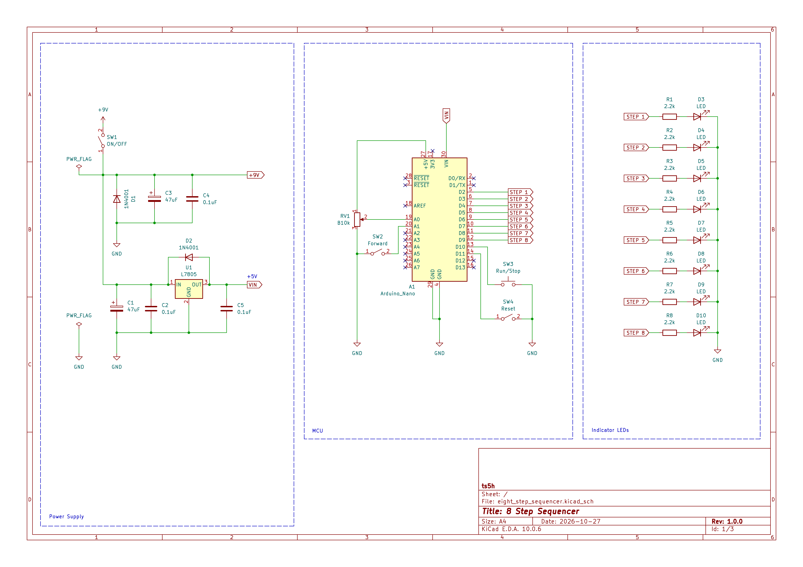
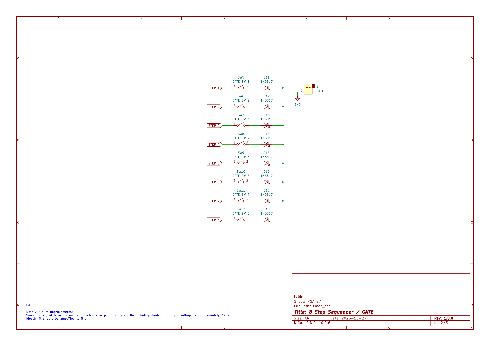
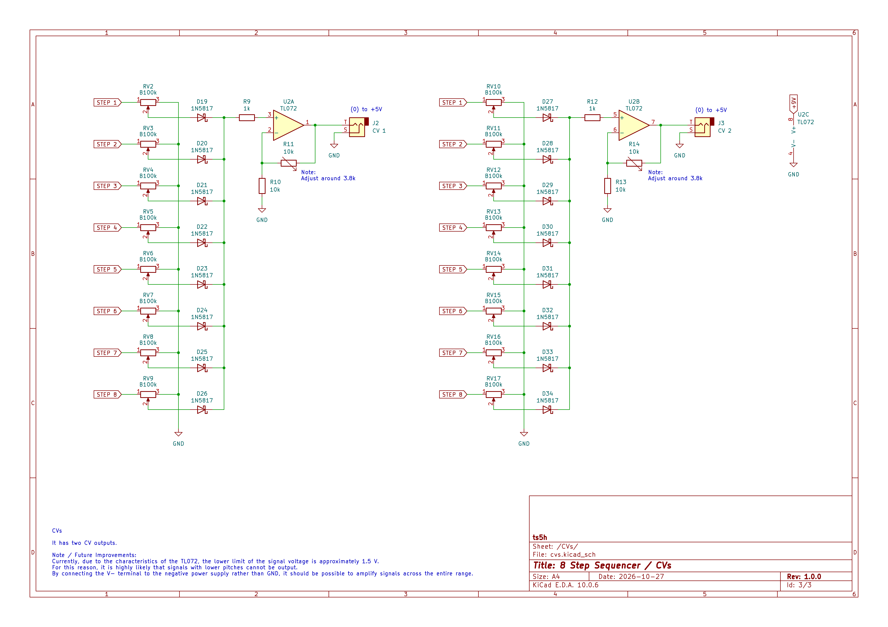

# 8 Step Sequencer

An 8 step sequencer using Arduino Nano.  
Inspired by Look Mum No Computer's Arduino 8 Step Sequencer Keyboard.
https://www.lookmumnocomputer.com/sequencer-keyboard

At first, I intended to create a clone of the one mentioned above to power my Atari Punk Console, but as I added some features I wanted, my code ended up becoming fully original.

## Features
- 2 CV Outputs
- 1 GATE Output
- Start / Stop
- Reset
- Step Forward
- About 40 to 240 BPM analog reading from a 10k POT

## Schematic

## LICENSE
[MIT License](LICENSE)
